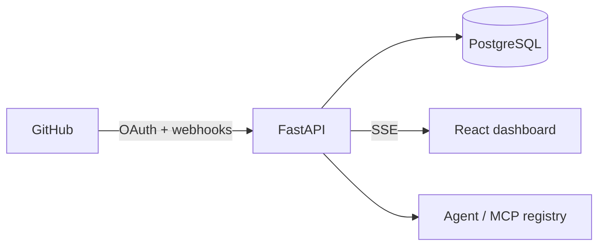

# OpsPilot

OpsPilot is a multi-tenant operations hub for GitHub-backed engineering teams. This repository contains a runnable FastAPI + React foundation: health checks, tenant-scoped event reads, SSE activity, webhook signature validation and replay deduplication, encrypted-token primitives, and a clean dashboard shell.

## Run

```bash
cp .env.example .env
docker compose up --build
```

The API is at `http://localhost:8000` and the dashboard at `http://localhost:5173`.

## Architecture



## Current scope and next steps

This clean-clone scaffold is the foundation for the six-phase specification. Remaining work includes the complete OAuth code exchange, Alembic migrations, GitHub backfill/polling worker, metrics and CSV endpoints, MCP server and LLM providers, confirmation UI, structured logging, and the full CI/test matrix.

Assumptions: the first webhook path uses tenant 1 until GitHub installation-to-tenant lookup is added; the local default database is SQLite for fast tests while Compose targets PostgreSQL; event streaming sends the current tenant's recent events as an initial snapshot.
